# kubectl – Readiness & Liveness probes

## Access endpoint /health

```bash
curl --fail --show-error --max-time 5 http://127.0.0.1:8080/health
```

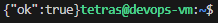

## Readiness

```bash
kubectl get pods -l app=quote-app
```

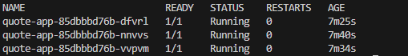

```bash
kubectl get pods -l app=quote-app
```

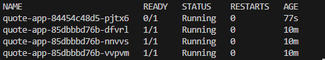

```bash
kubectl describe pod POD_NAME
```

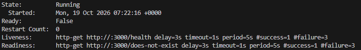


```bash
kubectl logs POD_NAME
```

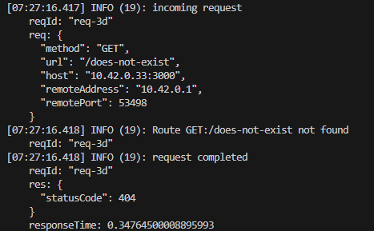

```bash
kubectl get endpointslices -l kubernetes.io/service-name=quote-app -o yaml
```

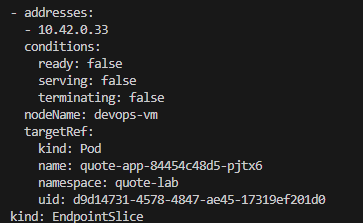

```bash
kubectl apply -f deployment.yaml
kubectl rollout status deployment/quote-app --timeout=120s
kubectl get pods -l app=quote-app
```

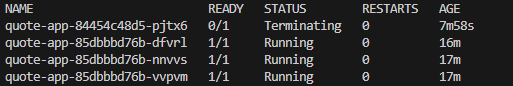

## Liveness (Lane B)

```yaml
livenessProbe:
  httpGet:
    path: /health
    port: 3000
  initialDelaySeconds: 3
  periodSeconds: 5
```

```bash
kubectl get pods -l app=quote-app
```

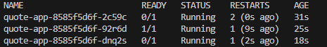

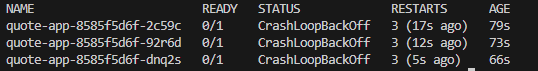

```bash
kubectl describe pod POD_NAME
```

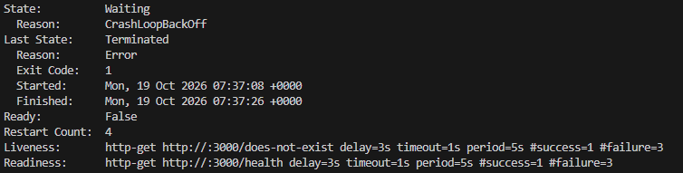

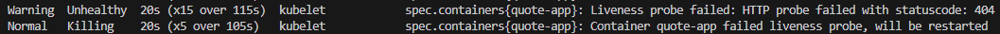

```bash
kubectl get endpointslices -l kubernetes.io/service-name=quote-app -o yaml
```

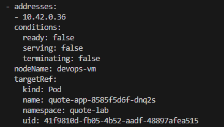

```bash
kubectl get pods -l app=quote-app
```


## Synthesis

- La **readiness probe** indique si un Pod est prêt à recevoir du trafic. Si elle échoue, le Pod est retiré du Service (`READY 0/1`), mais le conteneur n'est pas redémarré (`RESTARTS 0`).
- La **liveness probe** indique si le conteneur est encore en vie. Si elle échoue, Kubernetes le redémarre : `RESTARTS` augmente, puis le Pod passe en `CrashLoopBackOff`.
