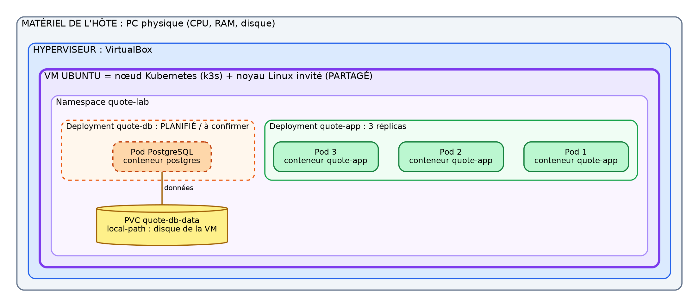
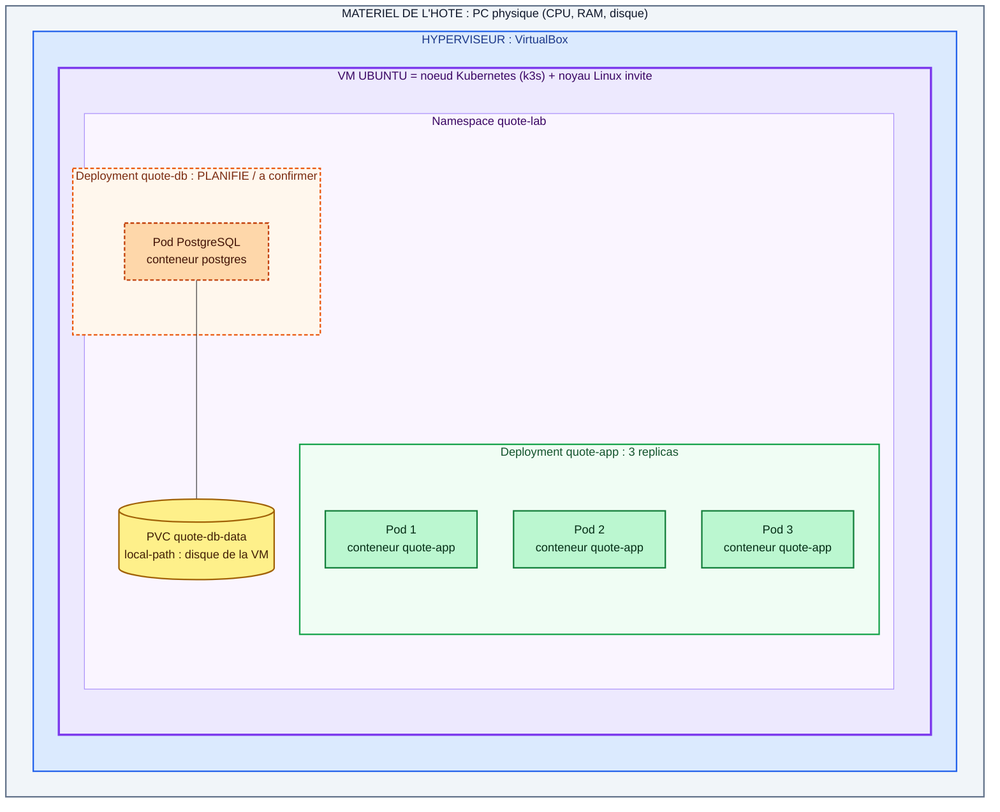
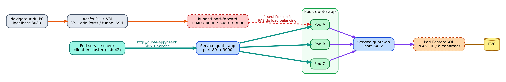
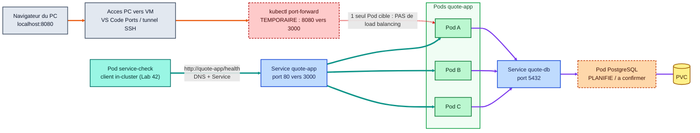

# Lab 52 · Architecture notes

> Système : `quote-app` (Node.js, port 3000) sur k3s, namespace `quote-lab`, dans une VM Ubuntu.

---

## 1. Schéma A : « tourne dans » (frontières)

Version Mermaid (s'affiche sur GitHub)

---

## 2. Schéma B : chemins de trafic

Version Mermaid (s'affiche sur GitHub)

**Lecture, trois trajets distincts :**

1. **Utilisateur** : navigateur, tunnel, port-forward, puis **un seul Pod**. Ce chemin ne démontre ni la répartition de charge ni la sélection des Pods Ready.
2. **In-cluster (turquoise épais)** : `service-check`, Service, puis les Pods Ready. Il passe par le DNS du cluster : c'est celui que vous avez vérifié au Lab 42.
3. **Base de données (violet)** : les Pods app, Service `quote-db`, PostgreSQL, PVC.

PostgreSQL est marqué **planifié / à confirmer** : retirez cette mention une fois le déploiement vérifié. Toute démonstration faite par l'instructeur doit être étiquetée **observed**.

> Les schémas sont des images PNG (`architecture-a.png`, `architecture-b.png`) : gardez-les dans le même dossier que ce fichier pour qu'ils s'affichent dans l'aperçu VS Code et sur GitHub. Vous pouvez aussi recopier un schéma à la main et ajouter une photo.

---

## 3. Notes de frontière

**Noyau partagé.** Les conteneurs de l'app et de la base partagent le noyau Linux de la VM Ubuntu ; l'hyperviseur fournit la frontière de la VM (isolation vis-à-vis de l'hôte), et Kubernetes gère les workloads à l'intérieur de cette VM.

**Stockage et pannes.** Un Pod de l'app peut être remplacé car il est sans état, et la citation survit au remplacement du Pod PostgreSQL car ses données sont sur le PVC ; en revanche, trois réplicas avec un stockage `local-path` sur une seule VM ne protègent pas contre la perte de la VM ou de son disque. Sauvegardes et conception multi-nœuds restent du travail futur, non fournis par ce cluster d'enseignement.

---

## 4. Ce qui survit à quoi

| Événement | Survit ? | Pourquoi |
|---|---|---|
| Suppression d'un Pod app | Oui | Le ReplicaSet recrée un Pod (nouveau nom), l'app est sans état |
| Suppression du Pod PostgreSQL | Oui (données) | Les données sont sur le PVC, remonté dans le nouveau Pod |
| Perte de la VM ou de son disque | **Non** | Un seul nœud, stockage `local-path` local, pas de sauvegarde |

---

## 5. Preuves

| Contrôle | Résultat |
|---|---|
| PVC `quote-db-data` | `Bound` : pvc-7f53ab9f-a31a-44bb-bc4a-c16a851f4cf2 |
| Pod PostgreSQL | `quote-db-...` : 7cb5c66d76-4r8wz |
| Citation (marqueur) | 
res509-1792400679
 |
